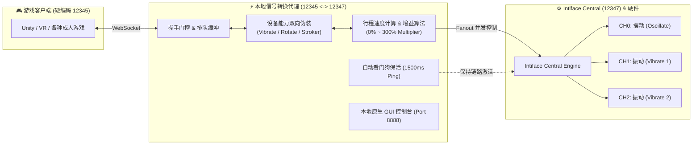

# Intiface Signal Converter (Intiface 信号转换代理与本地 GUI 控制面板)

[](LICENSE)
[](https://github.com)
[](https://buttplug.io/)

一个轻量、高效且功能完善的 **Buttplug.io / Intiface WebSocket 中继代理中间件**。

专门用于解决：**只支持单一振动（Vibrate）/ 旋转（Rotate）/ 活塞（Linear）信号的游戏，如何驱动具备多种物理执行器（如 摆动 + 振动1 + 振动2）的多通道设备（例如役次元三代等复合飞机杯）**。

自带 Windows 原生独立本地窗口（无黑框控制台），支持实时调节通道独立灵敏度增益，且内置了协议级握手排队与看门狗心跳保活机制。

---

## 🌟 核心特性 (Features)

1. **多物理通道扇出与独立增益 (Multi-Actuator Fanout)**
   - 游戏发出的单一控制信号（Vibrate / Rotate / Linear），自动同时映射并分发到硬件的所有物理通道（如 `Oscillate` 摆动 + `Vibrate` 振动1 + `Vibrate` 振动2）。
   - **每个通道拥有独立的开关与灵敏度调节滑块（0% ~ 300%）**，设置即时生效且自动持久化存储。
2. **设备能力双向伪装（Spec v2 & v3 全兼容）**
   - 针对部分游戏根据设备汇报能力决定是否发送信号的问题，代理在握手阶段拦截并伪装设备属性（可一键切换伪装为 **振动器**、**旋转器** 或 **活塞**）。
   - 彻底兼容老版 Buttplug Spec v2（`VibrateCmd`/`RotateCmd`/`LinearCmd`）和新版 Spec v3（`ScalarCmd`）。
3. **活塞行程速度自适应算法 (Stroker Dynamics Algorithm)**
   - 对于发送 `LinearCmd`（位置 + 持续时间）的游戏，算法实时根据行程距离 $\Delta \text{Position}$ 与移动耗时 $\Delta t$ 计算瞬时运动速度，并平滑归一化映射为摆动/振动强度；超时未收到指令时自动归零，杜绝卡机。
4. **握手门控保护与看门狗自动保活 (Handshake Gating & Keep-Alive)**
   - 针对 Unity/VR 等加载较慢的游戏，代理内置握手指令排队缓冲机制（Message Queueing），杜绝握手包丢失。
   - 握手完全成功前严禁向服务端乱发 Ping，彻底规避 Intiface 服务端的 `Error: MessageSpecVersionNotReceived` 报错。
   - 握手完成后自动启动 1500ms 保活心跳，彻底解决 Buttplug 的 `ServerPingTimeout` 安全看门狗超时导致设备被急停静音的问题。
5. **双启动模式与纯净本地窗口 (Native Desktop GUI)**
   - 内置基于 Microsoft Edge App 模式的本地独立应用窗口（尺寸 `680 × 880`），无浏览器地址栏、标签页与干扰元素。
   - 配备 C# 编写的微型启动器（WinExe 子系统），双击启动 **0 黑色控制台弹窗**，随开随关，优雅轻便。

---

## 🏗️ 架构与数据流 (Architecture)



---

## 🚀 快速上手 (Quick Start)

### 1. 配置 Intiface Central 端口
1. 打开 **Intiface Central** -> 点击设置（Settings / 齿轮图标）。
2. 在 **Websocket Server Settings** 中，将端口由默认的 `12345` 改为 **`12347`**。
3. 返回主界面，点击 **Start Server / Start Engine** 并正常扫描连接你的玩具。

### 2. 启动代理程序
- **本地窗口模式（推荐，无黑框）**：
  双击运行 `Intiface转换器(本地窗口).exe`。
- **源码模式（开发者）**：
  安装依赖后直接启动：
  ```bash
  npm install
  node proxy.js
  ```

### 3. 打开游戏
- 正常运行游戏，游戏会自动连接到本地 `12345` 端口。
- 在弹出的控制面板中，根据喜好调整各通道灵敏度即可！

---

## 🛠️ 项目源码结构

```text
├── proxy.js            # 后端核心通信与转换逻辑 (WebSocket 代理、双向伪装、通道扇出)
├── index.html          # 本地桌面 GUI 页面 (单文件内嵌 CSS/JS，无外部 CDN 依赖)
├── Launcher.cs         # Windows 原生无黑框启动器源码 (C# 5.0，编译后仅 5KB)
├── build.js            # 一键自动化单文件 EXE 打包脚本 (Node SEA + esbuild)
├── 启动代理.bat        # 开发者快速调试脚本
├── package.json        # 项目依赖清单
├── LICENSE             # MIT 开源许可证
└── README.md           # 项目文档
```

---

## 🔨 二次开发与编译打包

### 1. 安装开发依赖
```bash
npm install
```

### 2. 打包生成独立的单个 EXE
使用 Node.js SEA (Single Executable Application) 自动打包：
```bash
node build.js
```
生成产物将自动输出到 `dist/` 目录下。

### 3. 编译无黑框 C# 启动器
使用 Windows 自带的 .NET Framework C# 编译器直接编译：
```bash
C:\Windows\Microsoft.NET\Framework64\v4.0.30319\csc.exe /target:winexe /out:dist\Intiface转换器(本地窗口).exe /r:System.Windows.Forms.dll Launcher.cs
```

---

## 📄 开源许可证 (License)

本项目基于 [MIT License](LICENSE) 开源。
